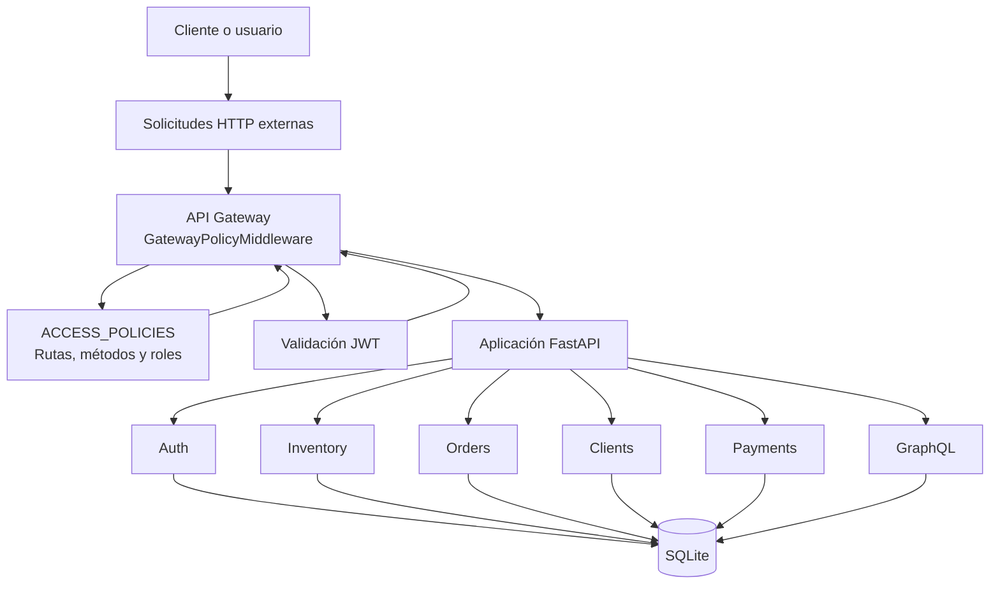

# Módulo 5 – API Gateway, políticas y fronteras de confianza
## Proyecto Fresh Bowl

## 1. Objetivo

Describir el funcionamiento del API Gateway de Fresh Bowl, las políticas de acceso aplicadas a las solicitudes HTTP, las fronteras de confianza y la separación de responsabilidades entre los componentes.

## 2. Arquitectura del Gateway

El API Gateway de Fresh Bowl se implementa mediante un middleware de FastAPI. Su responsabilidad principal es revisar las políticas de acceso antes de permitir que una solicitud continúe hacia los endpoints de la aplicación.

El middleware identifica la ruta y el método HTTP, determina si el recurso requiere autenticación y comprueba el rol incluido en el token JWT.

La implementación permite centralizar parte de las reglas de autorización y mantener una política de acceso consistente entre los módulos.

## 3. Diagrama de componentes

## 4. Funcionamiento del middleware

El procesamiento de una solicitud sigue estas etapas:

1. El usuario realiza una solicitud HTTP.
2. El middleware identifica la ruta y el método HTTP.
3. Se consulta la lista de políticas configuradas.
4. Si la operación es pública, la solicitud continúa.
5. Si requiere autenticación, se obtiene el token desde la cookie `access_token`.
6. Se valida el token JWT.
7. Se obtiene el rol asociado al token.
8. Se compara el rol con los roles autorizados para la operación.
9. Si la autorización es correcta, la solicitud continúa hacia el endpoint.
10. Si no existe autenticación válida, se responde HTTP 401; si el rol no está autorizado, se responde HTTP 403.

Los endpoints protegidos también utilizan dependencias de autorización que consultan al usuario en la base de datos y comprueban su estado y permisos.

## 5. Políticas de acceso

Las políticas se encuentran definidas en `app/gateway/policies.py`, mediante la estructura `ACCESS_POLICIES`.

| Recurso | Método HTTP | Roles permitidos |
|---|---|---|
| Ingredientes | GET | Público |
| Ingredientes | POST, PATCH, DELETE | Administrador |
| Clientes | GET, POST, PATCH, DELETE | Administrador |
| Pedidos | POST | Público |
| Pedidos | GET, PATCH | Administrador y técnico |
| Pagos | POST | Público |
| Pagos | GET | Administrador y técnico |
| Autenticación | POST | Público |
| Perfil | GET | Cliente, técnico y administrador |

Las operaciones GraphQL cuentan con autorización propia en su router y permiten el acceso a administradores y técnicos.

## 6. Fronteras de confianza

La arquitectura considera distintas fronteras de confianza:

### 6.1 Navegador del usuario

El navegador se considera un entorno externo. Los datos enviados desde el frontend deben validarse en el backend.

No se confía exclusivamente en los precios, cantidades ni estados enviados por el cliente.

### 6.2 API Gateway

El Gateway constituye el primer punto de control de acceso dentro de la aplicación. Aplica las políticas configuradas y verifica la autenticación cuando corresponde.

### 6.3 Servicios internos

Los módulos Auth, Inventory, Orders, Clients, Payments y GraphQL forman parte de la aplicación FastAPI.

Aunque están separados por responsabilidades, actualmente comparten el mismo proceso de ejecución y la infraestructura de persistencia.

### 6.4 Base de datos

La base de datos no debe exponerse directamente al navegador ni a usuarios externos. El acceso se realiza mediante los componentes del backend y las sesiones administradas por SQLAlchemy.

### 6.5 Gestor de secretos

HashiCorp Vault está contemplado para administrar credenciales y configuraciones sensibles. Su integración se encuentra preparada, pero todavía debe verificarse mediante una ejecución real.

## 7. Decisiones de separación

Se optó por una arquitectura modular en lugar de desplegar cada módulo como un microservicio independiente.

Las razones son:

- El alcance actual del proyecto permite mantener los módulos dentro de una misma aplicación.
- Los módulos comparten entidades y operaciones de persistencia.
- La separación lógica facilita organizar el código y las pruebas.
- Evita agregar complejidad de comunicación entre servicios que no resulta necesaria para el alcance actual.
- Permite mantener responsabilidades diferenciadas sin exigir infraestructura distribuida.

El Gateway se implementa como middleware porque las políticas de acceso pueden aplicarse dentro de la aplicación existente.

## 8. Limitaciones de la implementación actual

Es importante distinguir las capacidades implementadas de las que se encuentran contempladas para una etapa posterior:

- El Gateway aplica políticas de acceso, pero no funciona como proxy independiente.
- No existe una red de microservicios independientes con servicios internos aislados.
- Los módulos comparten la aplicación y la base de datos.
- La validación de roles del middleware utiliza la información del JWT; los endpoints protegidos complementan esta validación consultando al usuario en la base de datos.
- La integración con Vault debe verificarse en ejecución.
- Se deben configurar controles adicionales, como HTTPS, CORS y protección CSRF, antes de un despliegue de producción.

## 9. Evidencia de pruebas

La implementación cuenta con pruebas para verificar las políticas y los permisos de los recursos.

Entre las pruebas realizadas se encuentran:

- Consulta de recursos protegidos sin autenticación.
- Intentos de acceso con roles no autorizados.
- Acceso permitido para los roles correspondientes.
- Verificación de las políticas configuradas en el Gateway.

La ejecución global más reciente registró 56 pruebas aprobadas y ninguna fallida.

## 10. Conclusión

El API Gateway de Fresh Bowl centraliza la aplicación de políticas de acceso mediante un middleware de FastAPI. Su funcionamiento permite controlar las solicitudes según la ruta, el método HTTP y los roles autorizados.

La arquitectura mantiene una separación lógica entre módulos, sin presentarlos como microservicios independientes. Esta decisión responde al alcance actual del proyecto y permite mantener una implementación más sencilla y verificable.