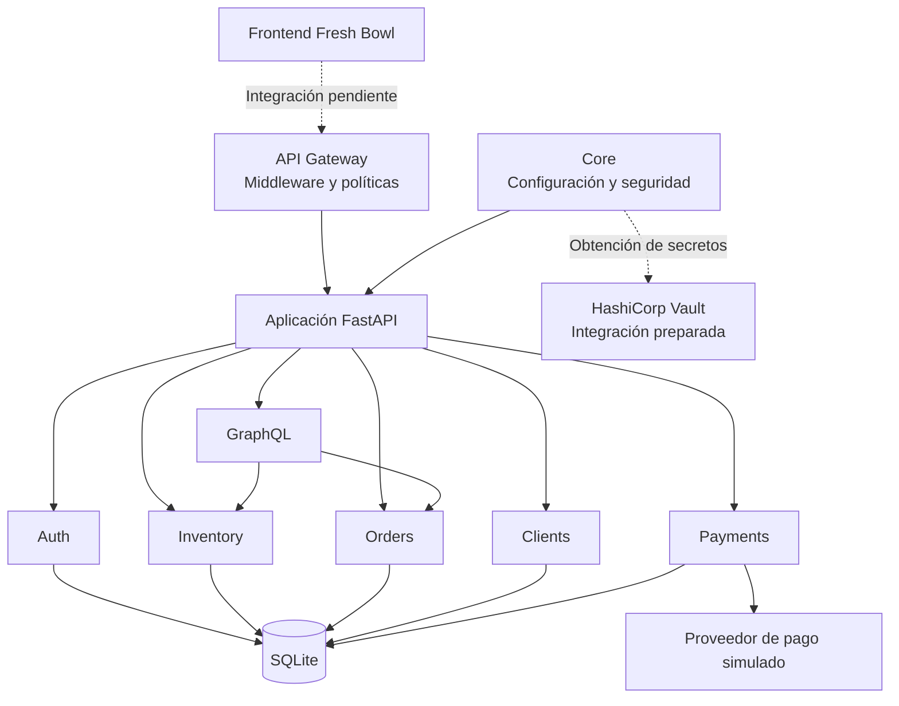

# Módulo 3 – Sistemas, componentes y persistencia
## Proyecto: Fresh Bowl

## 1. Objetivo

Describir los sistemas que participan en Fresh Bowl, sus responsabilidades, los mecanismos de comunicación y la persistencia de la información.

La arquitectura se organiza como un backend modular desarrollado con FastAPI. Cada módulo tiene responsabilidades específicas, pero todos forman parte de una misma aplicación.

## 2. Matriz de sistemas

| Sistema o componente | Responsabilidad | Tecnología | Comunicación |
|---|---|---|---|
| Frontend | Presentar el catálogo, personalización, carrito y confirmación de compra | HTML, CSS y JavaScript | Actualmente separado del backend |
| API Gateway | Aplicar políticas de acceso y validar permisos de las solicitudes | Middleware de FastAPI | Procesamiento HTTP dentro del backend |
| Auth | Registrar usuarios, iniciar sesión y validar identidad | FastAPI, JWT y cookies HttpOnly | Llamadas internas y acceso a la base de datos |
| Inventory | Administrar ingredientes, precios, existencias y disponibilidad | FastAPI y SQLAlchemy | Llamadas internas y base de datos |
| Orders | Registrar pedidos, calcular totales y gestionar sus estados | FastAPI y SQLAlchemy | Llamadas internas y base de datos |
| Clients | Administrar los datos de los clientes | FastAPI y SQLAlchemy | Llamadas internas y base de datos |
| Payments | Registrar pagos y comunicarse con el proveedor simulado | FastAPI y SQLAlchemy | Llamadas internas y base de datos |
| GraphQL | Consultar y consolidar información de inventario y pedidos | Strawberry GraphQL | Consultas internas a los módulos y base de datos |
| Base de datos | Almacenar usuarios, ingredientes, clientes, pedidos y pagos | SQLite y SQLAlchemy | Acceso mediante sesiones SQLAlchemy |
| Gestor de secretos | Centralizar la configuración sensible | HashiCorp Vault | Integración preparada mediante HVAC |
| Despliegue | Definir los servicios y su configuración de ejecución | Docker Compose | Contenedores y red interna configurada |

## 3. Persistencia de datos

La persistencia se implementa mediante SQLAlchemy, que permite interactuar con la base de datos desde los distintos módulos del backend.

SQLite se utiliza como motor de base de datos durante el desarrollo.

### Entidades principales

| Entidad | Información almacenada |
|---|---|
| User | Identificador, nombre, correo, contraseña cifrada mediante hash, rol y estado |
| Ingredient | Identificador, nombre, categoría, descripción, precio, stock y disponibilidad |
| Client | Identificador y datos de contacto del cliente |
| Order | Datos del comprador, modalidad de entrega, estado y total |
| Payment | Pedido asociado, monto, método, estado y referencia del proveedor |

### Relaciones principales

- Un pedido puede contener varios ingredientes y cantidades.
- Un ingrediente puede formar parte de distintos pedidos.
- Un pedido puede tener un pago asociado.
- Un usuario posee un rol que determina sus permisos.
- Los datos del cliente pueden asociarse a las operaciones de compra según el flujo implementado.

La relación entre pedidos e ingredientes se gestiona mediante los elementos del pedido, que permiten registrar las cantidades solicitadas.

## 4. Mapa de componentes

El siguiente diagrama representa la organización lógica actual del proyecto:

**Interpretación:** las solicitudes pasan por las políticas del Gateway y llegan a los módulos de la aplicación. Los módulos utilizan la persistencia compartida. GraphQL consulta información de Inventory y Orders para generar resultados consolidados. El proveedor de pagos es simulado.

## 5. Secuencia general de integración

El flujo principal de compra contempla las siguientes etapas:

1. El usuario revisa los ingredientes disponibles en el catálogo.
2. Selecciona los ingredientes que desea incorporar a su ensalada.
3. Administra su selección en el carrito.
4. Confirma el pedido e ingresa los datos necesarios.
5. El backend recibe la solicitud y valida los ingredientes, cantidades y precios.
6. El módulo Orders registra el pedido.
7. El módulo Payments procesa el pago mediante el proveedor simulado.
8. Si el pago se aprueba, se actualiza el estado del pedido.

El flujo representa la lógica prevista del caso y las operaciones implementadas en el backend. La conexión efectiva entre las pantallas del frontend y los endpoints debe demostrarse en la etapa de integración correspondiente.

## 6. Separación de responsabilidades

La arquitectura separa las responsabilidades para facilitar el mantenimiento y las pruebas:

- Auth administra la identidad y autenticación.
- Inventory administra los ingredientes y existencias.
- Orders concentra las reglas de los pedidos.
- Clients administra los datos de clientes.
- Payments gestiona el registro de pagos.
- GraphQL permite obtener información consolidada.
- Gateway aplica políticas de acceso.
- Core centraliza configuración, seguridad y conexión a la base de datos.

Esta separación es lógica y funcional. Los módulos no se despliegan actualmente como servicios independientes.

## 7. Estado de implementación

| Elemento | Estado |
|---|---|
| Backend modular FastAPI | Implementado |
| Persistencia SQLAlchemy y SQLite | Implementada para desarrollo |
| API Gateway y políticas | Implementados y probados |
| GraphQL | Implementado y probado |
| Proveedor de pagos | Simulado |
| Integración con Vault | Preparada, pendiente de verificación |
| Docker Compose | Configurado, pendiente de verificar el despliegue |
| Integración efectiva con frontend | Pendiente según alcance de la siguiente etapa |

## 8. Conclusión

Fresh Bowl utiliza una arquitectura modular que separa las responsabilidades principales del negocio y permite administrar la información mediante una base de datos compartida.

Esta organización facilita el desarrollo, la validación de reglas de negocio y la aplicación de controles de seguridad. Las tecnologías de despliegue y gestión de secretos están contempladas en la arquitectura, aunque su ejecución debe verificarse antes de considerarlas completamente operativas.